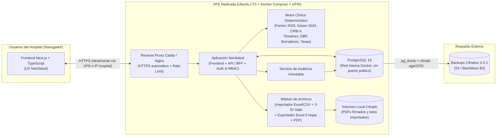

# 04 · Arquitectura del Sistema y Estrategia de Ambientes

NeoSalud corre como una **aplicación web contenerizada en una VPS dedicada**, con **PostgreSQL** como base transaccional única, arranque limpio en producción e importación estructurada de Excel/CSV. Se definen **4 ambientes independientes** (`dev`, `test`, `preprod`, `prod`).

---

## 1. Arquitectura de Despliegue en VPS

### Componentes lógicos
1. **Capa Web (Frontend):** Next.js + TypeScript con renderizado rápido, formularios condicionales reactivos y validación inmediata en cliente.
2. **Capa de API y Seguridad:** autenticación por sesiones `HttpOnly`, control de acceso por rol (RBAC) en cada operación, concurrencia optimista (`version`) y validación estricta de payloads.
3. **Motor Clínico Determinístico:** lógica pura y 100% testeable para Fenton 2025, Kaiser 2024, CRIB II, cálculo de días de soporte respiratorio, DBP Jensen/Bancalari, hitos nutricionales, detección de desfasaje en borradores y tricotomía estadística.
4. **Módulo de Archivos (sin IA):** parser determinístico de plantillas `.xlsx`/`.csv`, barrera de 3 identificadores, bandeja de revisión por lotes, generador de Excel Maestro de 5 hojas y generador de PDF institucional.
5. **Persistencia y Auditoría:** PostgreSQL 16 con tablas relacionales normalizadas + `audit_logs` inmutable (solo inserción) registrando usuario, rol, acción, entidad, diff de campos y timestamp.

---

## 2. Seguridad y Endurecimiento de VPS (Datos Sensibles de Salud)

Al tratarse de información clínica real (criticidad alta), la VPS aplica estas medidas obligatorias antes de pasar a producción:

| Capa | Control obligatorio |
| :--- | :--- |
| **Perímetro y red** | Firewall `UFW` permitiendo solo `80/443` y `SSH` exclusivamente por clave privada (sin contraseña) + `fail2ban`. Recomendado restringir acceso web a la IP fija del hospital o mediante VPN (`WireGuard` / `Tailscale`). |
| **Base de datos** | PostgreSQL corre exclusivamente en la red privada interna de Docker (`127.0.0.1` / red bridge), **nunca expuesto a internet**. |
| **Cifrado** | TLS 1.3 en tránsito (Caddy/Let's Encrypt). En reposo: volumen cifrado (LUKS / disco cifrado del proveedor VPS) y backups cifrados con `age` o `GPG` **antes** de enviarse al almacenamiento externo. |
| **Sesiones y contraseñas** | Hashing con `Argon2id`, cookies `HttpOnly + Secure + SameSite=Lax`, expiración por inactividad (20–30 min, crítico en PCs compartidas de guardia) y 2FA (TOTP) opcional para Jefatura y Admin. |
| **Backups y recuperación** | `pg_dump` automático diario (retención 30 días) + semanal (12 semanas) en storage externo cifrado, con prueba documentada de restauración antes del pase a producción. |

---

## 3. Estrategia de 4 Ambientes

El proyecto mantiene **4 ambientes estrictamente aislados** (bases de datos, variables de entorno, secretos y volúmenes separados):

| Ambiente | Propósito | Dónde corre | Datos iniciales | Políticas clave |
| :--- | :--- | :--- | :--- | :--- |
| **1. Desarrollo (`dev`)** | Construcción diaria de pantallas, lógica clínica y maqueta. | Local (Docker Compose) | Seed ficticio rico (prematuro `24+2`, término `38+4`, ingresos incompletos, etc.). | Hot reload, reset rápido de BD, sin datos reales de pacientes. |
| **2. Prueba (`test` / QA)** | Ejecución automática de tests (unitarios, integración, E2E) y QA funcional. | CI + contenedor efímero / subdominio QA | Fixtures determinísticas y escenarios borde (regresión de fórmulas y permisos). | Base descartable y recreable por cada corrida; bloquea despliegues si falla un test clínico. |
| **3. Preproducción (`preprod` / Staging)** | Réplica fiel de producción para validar despliegues, migraciones, backups y **mostrar demos a la clínica**. | VPS (instancia/subdominio aislado `preprod.neosalud...`) | Catálogos reales + seed ficticio demostrable (con banner visible `PREPRODUCCIÓN · DATOS FICTICIOS`). | Mismo Docker Compose, HTTPS y configuración de seguridad que `prod`, pero BD aislada. |
| **4. Producción (`prod`)** | Operación asistencial real del Servicio de Neonatología. | VPS dedicada (`neosalud...`) | **Arranque 100% limpio:** solo catálogos (CIE-10, gérmenes, antibióticos, sectores) y cuenta Admin inicial. | Backups 3-2-1 cifrados, acceso restringido, prohibido correr seeds demo, promociones solo desde `preprod` aprobado. |

> **Regla de oro:** nunca copiar datos reales de `prod` hacia `dev`, `test` o `preprod`. Toda prueba o demostración usa únicamente casos sintéticos/ficticios.

---

## 4. Modelo de Dominio de Alto Nivel (PostgreSQL)

Entidades centrales previstas para garantizar dato único, versionado e integridad:

- **Seguridad y Estructura:** `users`, `roles`, `sectors`, `beds`, `audit_logs`.
- **Catálogos cerrados:** `cie10_diagnoses`, `microorganisms`, `antibiotics`, `clinical_dictionaries`.
- **Paciente e Internación:** `patients` (identificación + 3-ID únicos), `admissions` (ID correlativo `NEO-AAAA-NNNNNN`, estado, sector actual, versión de concurrencia), `sector_transfers`.
- **Ingreso estructurado:** `admission_records` (campos perinatales, maternos, transición, resultados calculados Fenton 2025 / Kaiser 2024 / CRIB II), `admission_diagnoses`.
- **Líneas de tiempo y episodios:**
  - `respiratory_events` + `timeline_coverages` (estado `incomplete` / `complete_to_cutoff`).
  - `nutrition_events` (vía enteral / parenteral / suplementos).
  - `iaas_episodes` (con tabla puente de gérmenes y antibióticos).
  - `vascular_catheters`, `transfusions`, `rop_exams`, `surgeries`, `growth_measurements`.
- **Documentos clínicos versionados:** `clinical_drafts` (tipo `admission` / `epicrisis`, snapshot de datos fuente para calcular diff de desfasaje, texto editado, estado `draft` / `validated` / `amended`, `validated_by`, `validated_at`, `pdf_storage_key`).
- **Importación Excel/CSV:** `import_batches` (archivo origen, autor, estado), `import_rows` (datos parseados, resultado de verificación 3-ID, decisión humana `approved` / `rejected`, registro vinculado).

---

## 5. Especificación Referencial de VPS

| Recurso | Mínimo (Maqueta + Preprod + Prod inicial) | Recomendado (Prod dedicada + Preprod separada) |
| :--- | :--- | :--- |
| **CPU / RAM** | 2 vCPU · 4 GB RAM | 4 vCPU · 8 GB RAM |
| **Disco** | 50 GB NVMe | 80–120 GB NVMe cifrado |
| **SO** | Ubuntu 24.04 LTS | Ubuntu 24.04 LTS |

*Referencia de decisiones asociadas:* [ADR-001](./adr/ADR-001-arquitectura-vps-sin-ia.md) y [ADR-003](./adr/ADR-003-ambientes-y-estrategia-datos.md).
